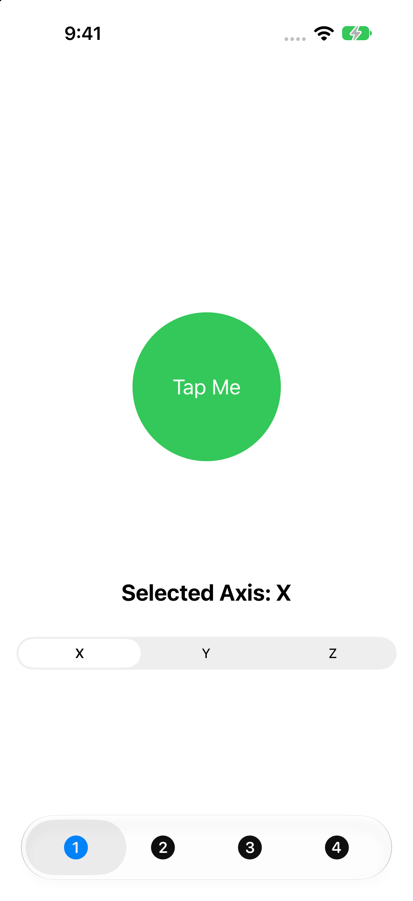
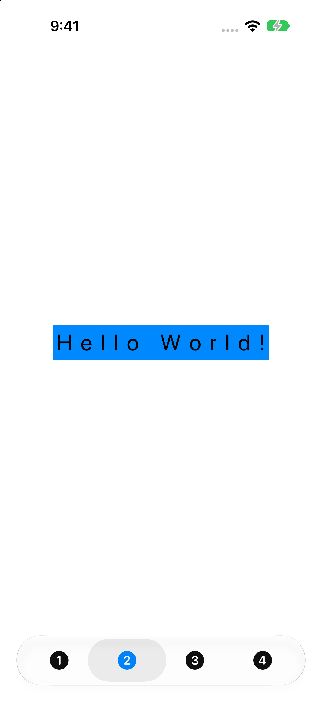
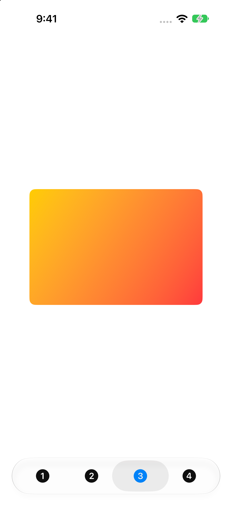
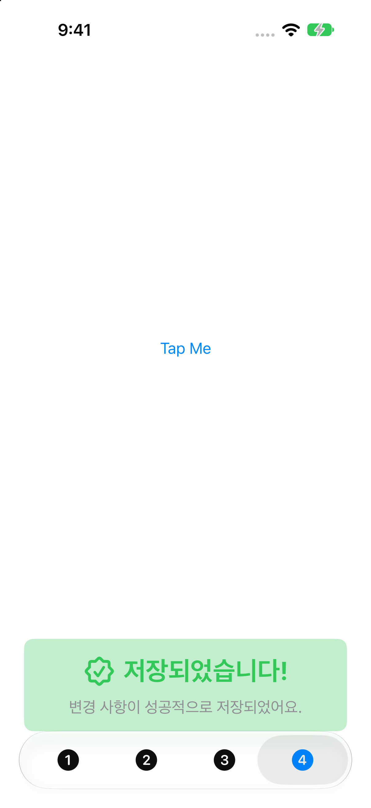

#   Animations

> [100 Days of SwiftUI](https://www.hackingwithswift.com/100/swiftui) · Day 32–34 · Project 6

SwiftUI의 상태 변화, 제스처, 뷰 삽입·제거에 애니메이션을 적용하는 실습 모음입니다.

## 주요 기능

- X·Y·Z 축 선택 및 버튼의 3D 회전, 확대, 색상 전환
- 글자별 시간 지연을 적용한 드래그 애니메이션
- 드래그 종료 시 스프링 효과로 원위치 복귀
- 저장 완료 메시지의 비대칭 전환
- 커스텀 회전 및 크기·투명도 전환 정의

## 핵심 학습 내용

| 개념 | 적용 내용 |
| :--- | :--- |
| `.animation(_:value:)` | 특정 상태 변경에 대한 암시적 애니메이션 |
| `withAnimation` | 상태 변경에 대한 명시적 애니메이션 |
| `.spring`, `.bouncy`, `.delay` | 움직임의 특성과 시작 시점 제어 |
| `DragGesture`, `CGSize` | 드래그 이동 거리 추적 |
| `.transition`, `.asymmetric` | 뷰의 삽입·제거 효과 구분 |
| `AnyTransition`, `ViewModifier` | 커스텀 전환 효과 구성 |

## 구현 및 학습 기록

- `ContentView.swift`: 3D 회전 및 축 선택 실습.
- `ContentView2.swift`: 글자별 지연 드래그와 종료 시 색상 전환. `ContentView3.swift`: 카드 드래그 및 복귀.
- `ContentView4.swift`: 아래에서 등장하고 투명하게 사라지는 저장 완료 메시지.
- `ContentView5.swift`: `pivot`, `customScale` 전환 정의 및 `pivot` 전환 적용. 각 실습은 개별 Preview로 확인할 수 있습니다.

## 실행 방법

1. 이 프로젝트 폴더의 `.xcodeproj` 파일을 Xcode에서 엽니다.
2. 프로젝트의 Deployment Target을 지원하는 iOS 시뮬레이터 또는 기기를 선택합니다.
3. `⌘R`로 빌드 및 실행합니다.

> 여러 실습 화면은 각 Swift 파일의 `#Preview`에서 개별적으로 확인할 수 있습니다.

## 실행 화면

iPhone 18 Pro · iOS 27.2 · 라이트 모드 · 상태 표시줄 9:41에서 직접 실행해 촬영했습니다.

| 탭 1 · X축 회전 후 상태 | 탭 2 · 글자 드래그 후 색상 전환 |
| :---: | :---: |
|  |  |

| 탭 3 · 드래그 가능한 카드 | 탭 4 · 저장 완료 메시지 |
| :---: | :---: |
|  |  |

## 향후 개선 방향

- 동일 화면에서 다양한 전환 효과를 선택해 비교하는 실습 추가

---

[전체 학습 목차로 돌아가기](../README.md)
