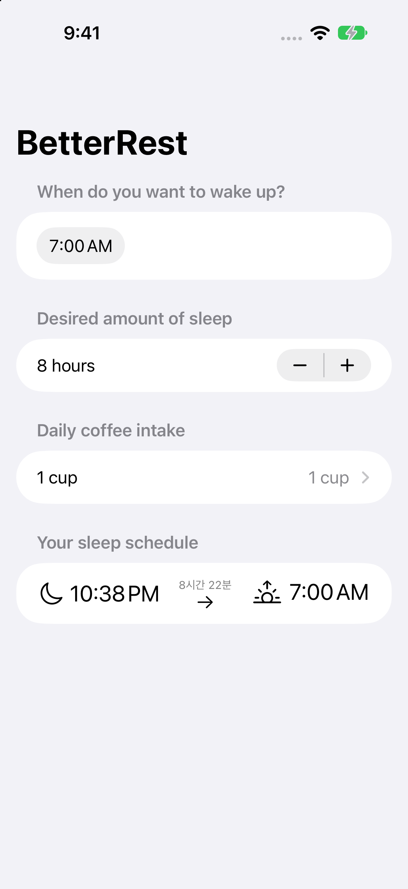
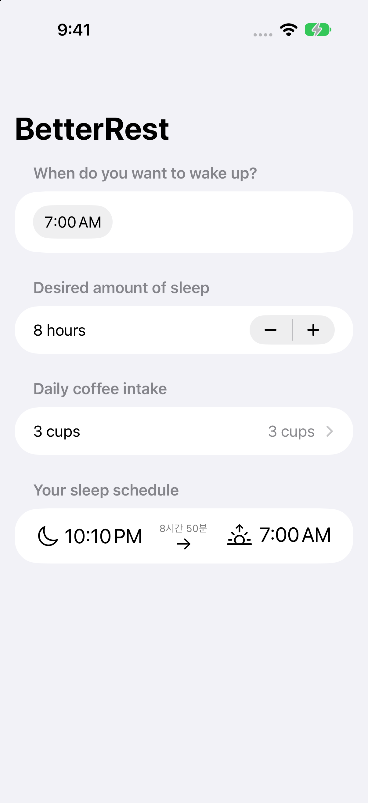

# BetterRest

> [100 Days of SwiftUI](https://www.hackingwithswift.com/100/swiftui) · Day 26–28 · Project 4

기상 시각, 희망 수면 시간, 하루 커피 섭취량을 입력하면 Core ML 모델을 이용해 취침 시각을 예측하는 학습용 앱입니다.

## 주요 기능

- 기상 시간, 희망 수면 시간, 커피 잔 수 설정
- `SleepCalculator` 모델로 예상 수면 시간 계산
- 입력값에 따라 취침·기상 시각 및 예상 수면 시간 표시
- 예측 실패 시 오류 문구 표시

## 핵심 학습 내용

| 개념 | 적용 내용 |
| :--- | :--- |
| `DatePicker`, `Stepper`, `Picker` | 시간 및 수치 입력 |
| `DateComponents`, `Calendar` | 기상 시각을 자정 기준 초 단위로 변환 |
| Core ML, `MLModelConfiguration` | 학습된 회귀 모델 로딩과 예측 |
| `Date`, `TimeInterval` | 기상 시각에서 예측 수면 시간을 차감 |
| `do-catch`, Optional | 예측 오류 처리 |
| SF Symbols, `.minimumScaleFactor` | 수면 일정 시각화 및 글자 크기 조절 |

## 구현 및 학습 기록

- 커피 입력을 `Picker`로 변경하고 각 선택값에 `.tag(number)`를 부여했습니다.
- 별도 계산 버튼 대신 입력에 반응해 결과를 표시하며, 취침 시각과 기상 시각 사이에 수면 시간을 배치했습니다.
- 모델의 초 단위 예측값을 시간·분 단위로 변환했습니다.

## 실행 방법

1. 이 프로젝트 폴더의 `.xcodeproj` 파일을 Xcode에서 엽니다.
2. 프로젝트의 Deployment Target을 지원하는 iOS 시뮬레이터 또는 기기를 선택합니다.
3. `⌘R`로 빌드 및 실행합니다.

> Core ML 모델이 프로젝트 타깃에 포함되어 `SleepCalculator` 타입을 사용할 수 있어야 합니다. 모델 파일을 이동한 경우 Xcode의 파일 참조를 확인합니다. 이 앱은 학습용 예측 예제이며 의학적 수면 권고를 제공하지 않습니다.

## 실행 화면

iPhone 18 Pro · iOS 27.2 · 라이트 모드 · 상태 표시줄 9:41에서 직접 실행해 촬영했습니다.

| 기상 7시 · 수면 8시간 · 커피 1잔 | 커피 3잔으로 변경한 예측 |
| :---: | :---: |
|  |  |

## 향후 개선 방향

- 모델 생성 및 예측 호출 비용 최적화
- 예측 결과와 날짜 경계 처리 검증

---

[전체 학습 목차로 돌아가기](../README.md)
