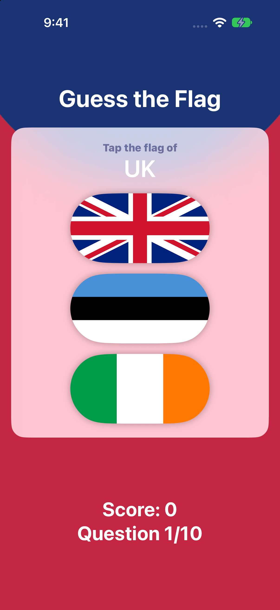
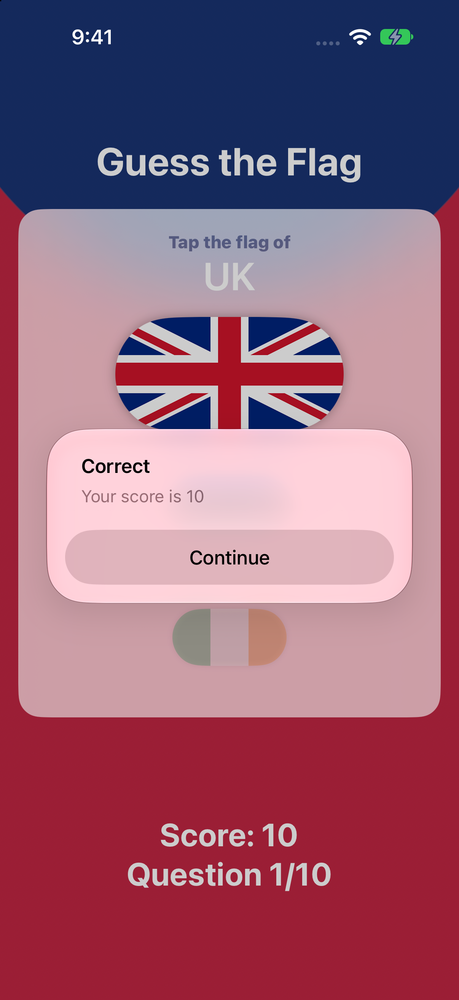
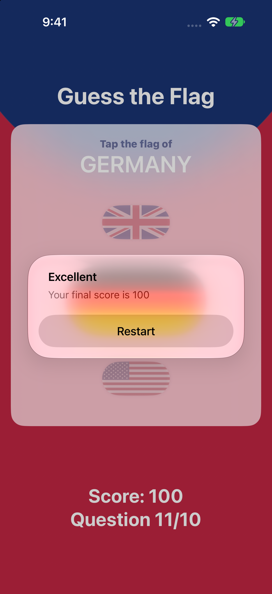

# GuessTheFlag

> [100 Days of SwiftUI](https://www.hackingwithswift.com/100/swiftui) · Day 20–22 · Project 2

제시된 국가명에 해당하는 국기를 선택하는 퀴즈 게임입니다. 이후 애니메이션 학습 내용을 추가 적용했습니다.

## 주요 기능

- 무작위로 제시되는 세 개의 국기 중 정답 선택
- 10문제 진행, 정답당 10점, 최종 점수 및 재시작
- 선택한 국기 회전 및 나머지 국기의 투명도·크기 변경
- 문제 번호 변경 시 확대·복귀 애니메이션

## 핵심 학습 내용

| 개념 | 적용 내용 |
| :--- | :--- |
| `ZStack`, `VStack`, `RadialGradient` | 배경 및 게임 화면 구성 |
| `@State`, `.alert` | 점수, 문제 번호, 결과 알림 관리 |
| `ForEach`, `shuffled()` | 국기 선택지 및 문제 생성 |
| `ViewModifier`, 하위 뷰 | 타이틀 스타일과 국기 이미지 재사용 |
| `withAnimation`, `.rotation3DEffect` | 선택 피드백 구성 |
| `.keyframeAnimator` | 문제 번호 변경에 반응하는 단계별 애니메이션 |

## 구현 및 학습 기록

- `FlagImage`와 `GameTitleModifier`를 분리해 반복되는 화면 스타일을 재사용했습니다.
- 선택한 국기 인덱스를 기준으로 회전, 투명도, 크기를 조건부 적용하고 애니메이션 완료 후 정답을 처리합니다.
- 문제 번호 상태와 키프레임 트리거를 연결해 다음 문제로 넘어가는 시각적 피드백을 구현했습니다.

## 실행 방법

1. 이 프로젝트 폴더의 `.xcodeproj` 파일을 Xcode에서 엽니다.
2. 프로젝트의 Deployment Target을 지원하는 iOS 시뮬레이터 또는 기기를 선택합니다.
3. `⌘R`로 빌드 및 실행합니다.

## 실행 화면

iPhone 18 Pro · iOS 27.2 · 라이트 모드 · 상태 표시줄 9:41에서 직접 실행해 촬영했습니다.

| 국기 선택 문제 | 정답 피드백 | 10문제 완료 · 100점 |
| :---: | :---: | :---: |
|  |  |  |

## 향후 개선 방향

- 애니메이션 진행 중 중복 입력 방지
- 마지막 문제에서 문제 번호 표시 범위 검증

---

[전체 학습 목차로 돌아가기](../README.md)
