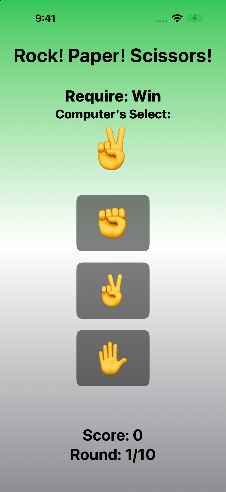
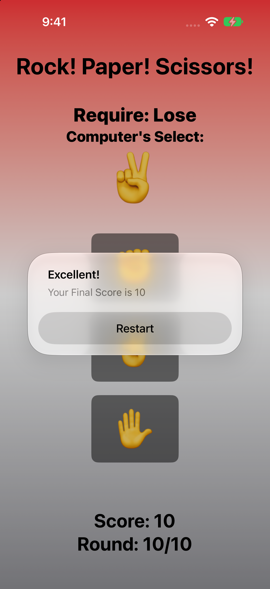

# RockPaperScissors

> [100 Days of SwiftUI](https://www.hackingwithswift.com/100/swiftui) · Day 25 · Milestone

컴퓨터가 낸 가위·바위·보를 보고 주어진 승리 또는 패배 조건을 만족시키는 게임입니다.

## 주요 기능

- 컴퓨터의 선택과 승리·패배 요구 조건 무작위 표시
- 승리, 패배, 무승부를 구분한 정답 판정
- 10라운드 진행 및 점수 관리
- 요구 조건에 따른 배경색 변경, 라운드별 결과 알림 및 재시작

## 핵심 학습 내용

| 개념 | 적용 내용 |
| :--- | :--- |
| `@State` | 라운드, 점수, 컴퓨터 선택 관리 |
| `didSet` | 점수 하한 및 선택값 갱신 로직 실습 |
| `switch` | 가위바위보 승리 판정 |
| `ForEach` | 이모지 선택 버튼 생성 |
| 조건부 스타일 | 승리·패배 조건에 따라 화면 변경 |
| `.alert` | 라운드 결과 및 최종 점수 표시 |

## 구현 및 학습 기록

- 승리 판정과 요구 조건 충족 여부를 분리해 무승부를 패배 정답으로 처리하지 않도록 구성했습니다.
- 점수가 음수가 되지 않도록 하한을 설정했습니다. 컴퓨터 선택 중복을 줄이기 위한 재추첨도 구현했지만, 한 번의 재추첨만으로는 중복 방지를 보장하지 않습니다.
- 현재 요구 조건은 매 라운드 셔플되므로 승리와 패배가 반드시 번갈아 나타나지는 않습니다.

## 실행 방법

1. 이 프로젝트 폴더의 `.xcodeproj` 파일을 Xcode에서 엽니다.
2. 프로젝트의 Deployment Target을 지원하는 iOS 시뮬레이터 또는 기기를 선택합니다.
3. `⌘R`로 빌드 및 실행합니다.

## 실행 화면

iPhone 18 Pro · iOS 27.2 · 라이트 모드 · 상태 표시줄 9:41에서 직접 실행해 촬영했습니다.

| 승패 조건에 맞춰 선택 | 10라운드 완료 · 10점 |
| :---: | :---: |
|  |  |

## 향후 개선 방향

- 승리·패배 조건을 반드시 교대로 제시하도록 개선할지 검토
- 게임 규칙을 enum으로 표현하고 판정 테스트 추가

---

[전체 학습 목차로 돌아가기](../README.md)
