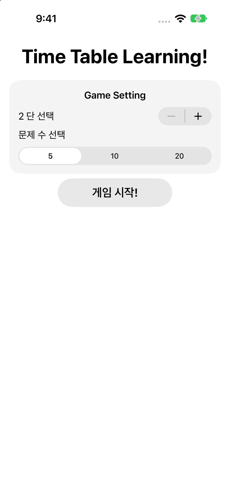
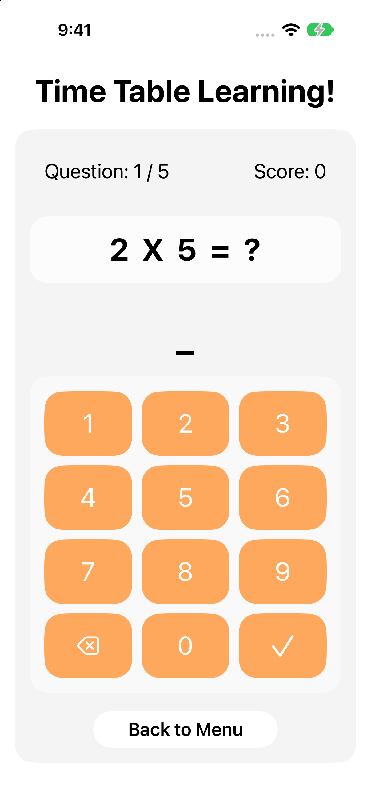
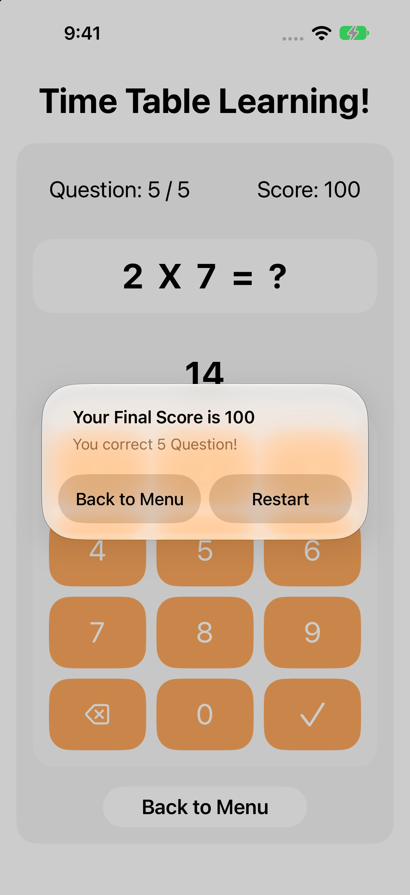

# Times Table

> [100 Days of SwiftUI](https://www.hackingwithswift.com/100/swiftui) · Day 35 · Milestone

사용자가 선택한 구구단을 무작위 문제로 연습하고 점수를 확인하는 학습 게임입니다.

## 주요 기능

- 2–12단 및 5·10·20문제 선택
- 2–9 사이의 곱수를 무작위 생성
- 자체 숫자 키패드로 답 입력 및 삭제
- 문제 진행, 점수 및 정답 수 표시
- 최종 결과 알림과 재시작·메뉴 복귀

## 핵심 학습 내용

| 개념 | 적용 내용 |
| :--- | :--- |
| `@State`, 계산 프로퍼티 | 게임 설정, 점수와 진행 상태 관리 |
| `Stepper`, `Picker` | 단과 문제 수 선택 |
| 중첩 `ForEach` | 숫자 키패드 배치 |
| `Int.random` | 설정에 따른 문제 배열 생성 |
| `ViewModifier` | 반복되는 배경 스타일 재사용 |
| `withAnimation`, `.keyframeAnimator` | 화면 전환 및 문제 번호 변화 효과 |

## 구현 및 학습 기록

- 시스템 키보드 대신 직접 숫자 키패드를 구성하고 앞자리 0 및 세 자리 초과 입력을 제한했습니다.
- 문제 수에 따라 정답당 배점을 100점 기준으로 계산하며, 시작·재시작·메뉴 복귀 시 게임 상태를 초기화합니다.
- 공통 배경 수정자와 애니메이션으로 이전 프로젝트의 뷰 합성 학습 내용을 응용했습니다.

## 실행 방법

1. 이 프로젝트 폴더의 `.xcodeproj` 파일을 Xcode에서 엽니다.
2. 프로젝트의 Deployment Target을 지원하는 iOS 시뮬레이터 또는 기기를 선택합니다.
3. `⌘R`로 빌드 및 실행합니다.

## 실행 화면

iPhone 18 Pro · iOS 27.2 · 라이트 모드 · 상태 표시줄 9:41에서 직접 실행해 촬영했습니다.

| 2단 · 5문제 설정 | 문제와 커스텀 숫자 키패드 | 5문제 완료 · 100점 |
| :---: | :---: | :---: |
|  |  |  |

## 향후 개선 방향

- 게임 상태 및 문제 모델을 별도 타입으로 분리
- 정답 판정과 점수 계산 테스트 추가

---

[전체 학습 목차로 돌아가기](../README.md)
