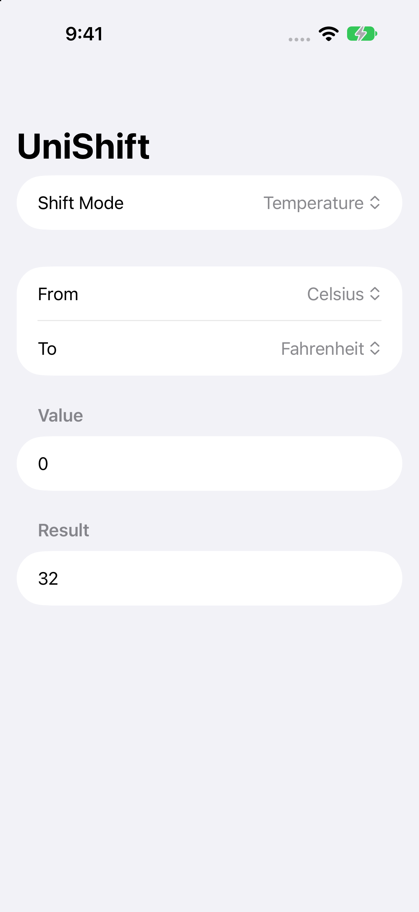
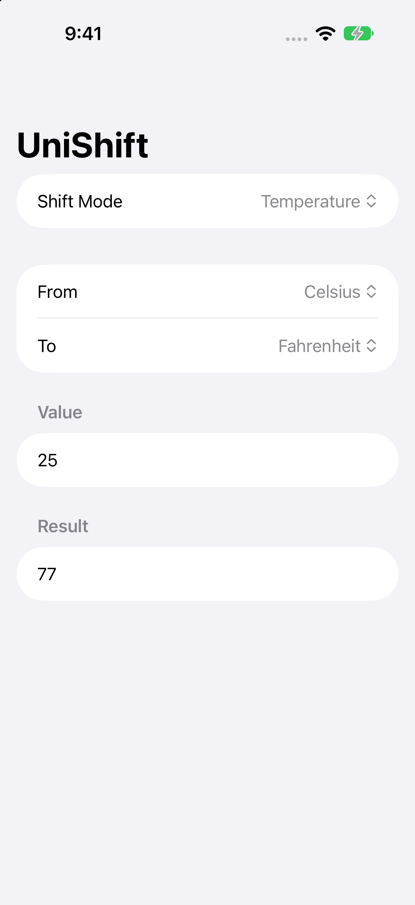

# UnitShift

> [100 Days of SwiftUI](https://www.hackingwithswift.com/100/swiftui) · Day 19 · Challenge

온도, 길이, 시간, 부피의 단위를 변환하는 앱입니다.

## 주요 기능

- 변환 종류 및 시작·목표 단위 선택
- 수치 입력에 따른 변환 결과 표시
- 변환 종류 변경 시 선택 단위 초기화
- 초·분·시간·일을 포함한 시간 단위 변환 및 키보드 포커스 제어

## 핵심 학습 내용

| 개념 | 적용 내용 |
| :--- | :--- |
| `Measurement` | Foundation의 단위 변환 기능 활용 |
| `UnitTemperature`, `UnitLength`, `UnitDuration`, `UnitVolume` | 변환 범주별 단위 표현 |
| `extension`, `UnitConverterLinear` | 일(day) 단위 직접 정의 |
| `.onChange` | 변환 범주 변경 시 종속 선택값 초기화 |
| `@State`, `@FocusState` | 입력 및 키보드 상태 관리 |
| 계산 프로퍼티 | 현재 선택값에서 결과 도출 |

## 구현 및 학습 기록

- 변환 공식을 직접 나열하는 대신 `Measurement`를 활용해 온도처럼 단순 비례가 아닌 변환도 처리했습니다.
- 변환 범주를 변경할 때 이전 단위가 남지 않도록 시작·목표 단위를 새 목록의 항목으로 초기화했습니다.

## 실행 방법

1. 이 프로젝트 폴더의 `.xcodeproj` 파일을 Xcode에서 엽니다.
2. 프로젝트의 Deployment Target을 지원하는 iOS 시뮬레이터 또는 기기를 선택합니다.
3. `⌘R`로 빌드 및 실행합니다.

## 실행 화면

iPhone 18 Pro · iOS 27.2 · 라이트 모드 · 상태 표시줄 9:41에서 직접 실행해 촬영했습니다.

| 섭씨 0도 → 화씨 32도 | 섭씨 25도 → 화씨 77도 |
| :---: | :---: |
|  |  |

## 향후 개선 방향

- 문자열 기반 범주와 단위를 enum으로 모델링
- 변환 로직 중복을 줄이고 경계값 테스트 추가

---

[전체 학습 목차로 돌아가기](../README.md)
