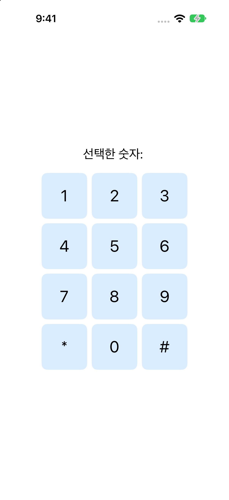
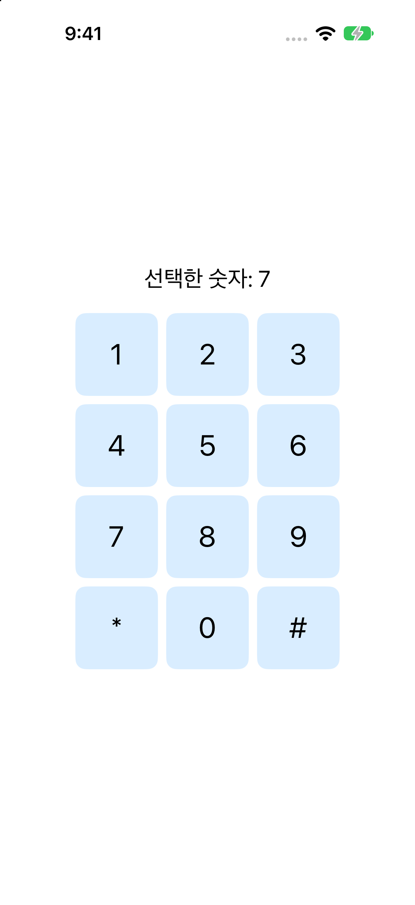

# ViewsAndModifiers

> [100 Days of SwiftUI](https://www.hackingwithswift.com/100/swiftui) · Day 23–24 · Project 3

SwiftUI 뷰 합성과 재사용 가능한 수정자, 제네릭 레이아웃을 연습하는 프로젝트입니다.

## 주요 기능

- 4×3 숫자 키패드 및 선택한 문자 표시
- 행과 열 개수를 전달받는 범용 `GridStack` 구현
- 재사용 가능한 `CapsuleText`와 `ProfileCard` 정의
- 타이틀 및 워터마크 커스텀 수정자 정의

## 핵심 학습 내용

| 개념 | 적용 내용 |
| :--- | :--- |
| `some View` | 뷰의 반환 타입 표현 |
| `ViewModifier`, `extension View` | 반복되는 스타일을 수정자로 캡슐화 |
| `@ViewBuilder` | 호출부에서 전달된 뷰 구성 |
| 제네릭 `Content: View` | 다양한 셀 뷰를 받는 레이아웃 구성 |
| 중첩 `ForEach` | 행과 열을 반복 생성 |
| `@State` | 키패드 선택 상태 관리 |

## 구현 및 학습 기록

- `GridStack`에 셀 생성 클로저를 전달하여 레이아웃과 셀의 표현을 분리했습니다.
- 프로필 카드와 워터마크 수정자는 별도로 정의되어 있으며, 현재 기본 `ContentView`는 키패드 실습을 표시합니다.

## 실행 방법

1. 이 프로젝트 폴더의 `.xcodeproj` 파일을 Xcode에서 엽니다.
2. 프로젝트의 Deployment Target을 지원하는 iOS 시뮬레이터 또는 기기를 선택합니다.
3. `⌘R`로 빌드 및 실행합니다.

## 실행 화면

iPhone 18 Pro · iOS 27.2 · 라이트 모드 · 상태 표시줄 9:41에서 직접 실행해 촬영했습니다.

| GridStack 숫자 키패드 | 숫자 7 선택 |
| :---: | :---: |
|  |  |

## 향후 개선 방향

- 각 실습 뷰의 독립적인 Preview 추가
- 뷰 수정자 순서에 따른 결과 비교 기록

---

[전체 학습 목차로 돌아가기](../README.md)
