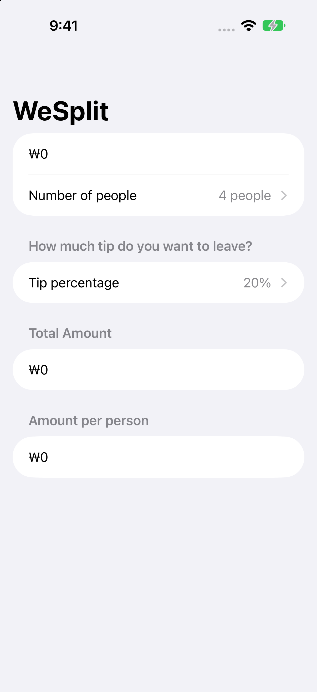
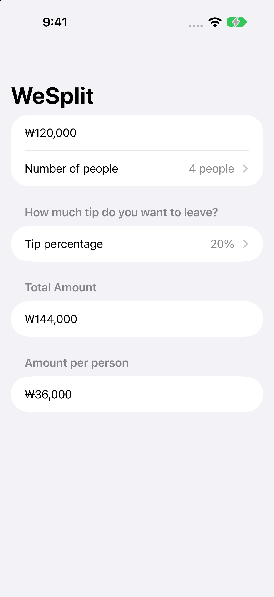

# WeSplit

> [100 Days of SwiftUI](https://www.hackingwithswift.com/100/swiftui) · Day 16–18 · Project 1

식사 비용과 팁을 입력하고 여러 사람이 나누어 낼 금액을 계산하는 앱입니다.

## 주요 기능

- 결제 금액, 인원수, 팁 비율 입력
- 팁을 포함한 전체 결제 금액 및 1인당 부담 금액 계산
- 현재 로케일에 따른 통화 표시
- 키보드 완료 버튼 및 팁이 0%일 때 전체 금액 색상 변경

## 핵심 학습 내용

| 개념 | 적용 내용 |
| :--- | :--- |
| `@State`, `$` | 입력값과 선택값을 상태로 관리하고 UI와 연결 |
| `Form`, `Section` | 입력과 계산 결과를 구역별로 구성 |
| `Picker`, `ForEach` | 인원 및 팁 선택 항목 생성 |
| 계산 프로퍼티 | 입력 변경에 따라 총액과 1인당 금액을 계산 |
| `@FocusState` | 키보드 포커스 제어 |
| `FormatStyle` | 지역 설정에 맞는 통화 형식 적용 |

## 구현 및 학습 기록

- 총액을 별도의 계산 프로퍼티로 분리하고 팁을 0%부터 100%까지 선택하도록 구성했습니다.
- `Picker`의 선택값과 실제 인원수 사이의 관계를 구분하는 것이 중요합니다. 현재 코드는 인원 선택값에 2를 더해 계산하므로, 표시되는 인원과 계산에 사용되는 인원이 일치하는지 확인할 필요가 있습니다.

## 실행 방법

1. 이 프로젝트 폴더의 `.xcodeproj` 파일을 Xcode에서 엽니다.
2. 프로젝트의 Deployment Target을 지원하는 iOS 시뮬레이터 또는 기기를 선택합니다.
3. `⌘R`로 빌드 및 실행합니다.

## 실행 화면

iPhone 18 Pro · iOS 27.2 · 라이트 모드 · 상태 표시줄 9:41에서 직접 실행해 촬영했습니다.

| 기본 화면 | 120,000원 · 팁 20% 계산 |
| :---: | :---: |
|  |  |

## 향후 개선 방향

- 인원 선택값과 계산값의 일치 여부 검증
- 금액 계산 중복 제거 및 입력값 검증

---

[전체 학습 목차로 돌아가기](../README.md)
