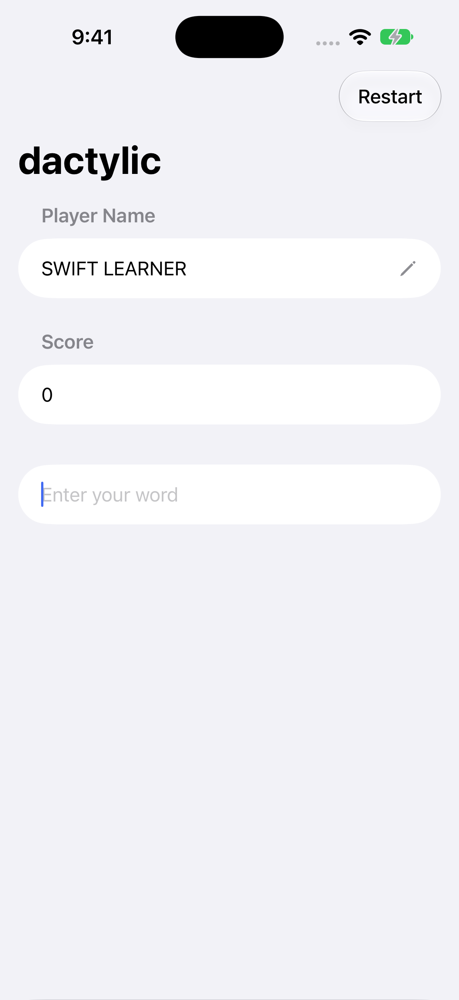
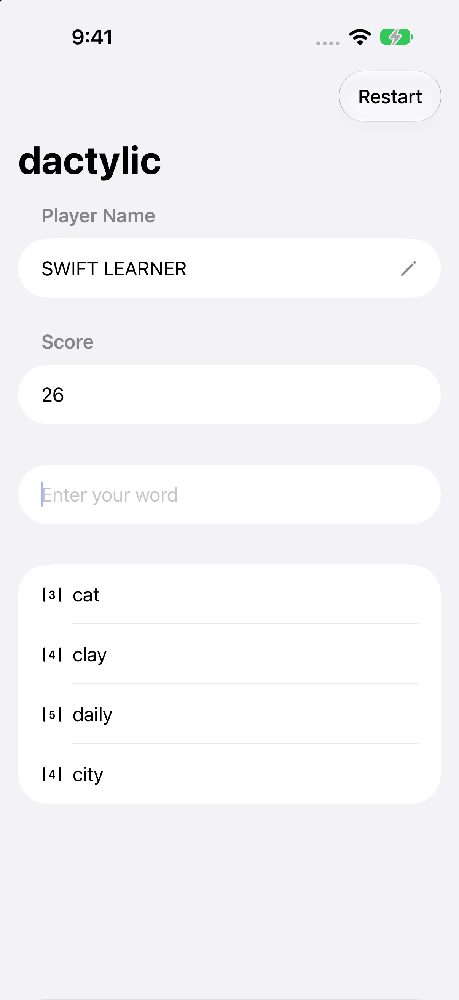
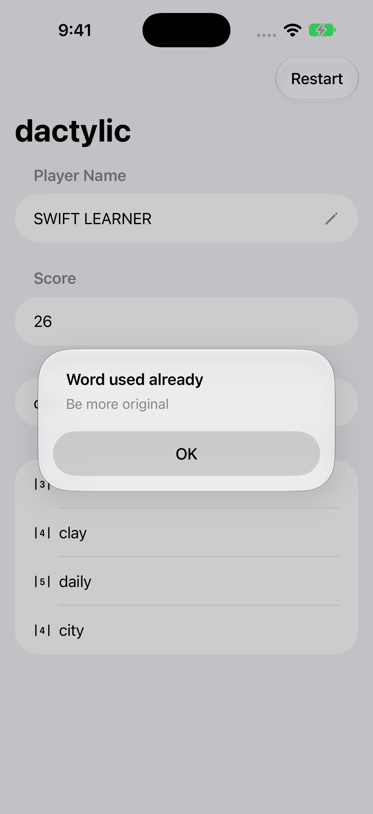

# WordScramble

> [100 Days of SwiftUI](https://www.hackingwithswift.com/100/swiftui) · Day 29–31 · Project 5

주어진 영어 단어의 글자를 활용해 새로운 영어 단어를 만드는 게임입니다.

## 주요 기능

- 앱 번들의 `start.txt`에서 시작 단어 무작위 선택
- 입력 단어의 길이, 중복 여부, 글자 구성 및 영어 철자 검사
- 플레이어 이름 설정 및 수정
- 성공한 단어 목록, 점수, 재시작 및 오류 알림

## 핵심 학습 내용

| 개념 | 적용 내용 |
| :--- | :--- |
| `Bundle`, `String(contentsOf:encoding:)` | 앱 리소스 및 UTF-8 문자열 로딩 |
| `guard`, 문자열 처리 | 입력 정규화와 단계별 검증 |
| `UITextChecker`, `NSRange` | 영어 단어 철자 검사 |
| `List`, `ForEach` | 성공한 단어 목록 표시 |
| `@FocusState`, `Hashable` enum | 이름과 단어 입력 포커스 통합 관리 |
| `.onSubmit`, `withAnimation` | 입력 제출 및 목록 갱신 애니메이션 |

## 구현 및 학습 기록

- 이름 입력과 수정 기능을 추가하고 두 입력창의 포커스를 단일 `FocusField` enum으로 통합했습니다.
- 정답 점수는 단어 길이와 현재까지 등록한 단어 수를 합산하는 방식으로 부여합니다.
- 문자열 로딩에 인코딩을 지정해 기존 initializer의 deprecated 경고에 대응했습니다.

## 실행 방법

1. 이 프로젝트 폴더의 `.xcodeproj` 파일을 Xcode에서 엽니다.
2. 프로젝트의 Deployment Target을 지원하는 iOS 시뮬레이터 또는 기기를 선택합니다.
3. `⌘R`로 빌드 및 실행합니다.

> `start.txt`가 앱 번들에 포함되어 있어야 합니다.

## 실행 화면

iPhone 18 Pro · iOS 27.2 · 라이트 모드 · 상태 표시줄 9:41에서 직접 실행해 촬영했습니다.

| 플레이어 설정과 시작 단어 | 인정된 단어 4개 · 26점 | 중복 단어 검증 알림 |
| :---: | :---: | :---: |
|  |  |  |

## 향후 개선 방향

- 리소스 로딩 실패 시 안전한 대체 동작 추가
- 단어 검증 및 점수 로직을 분리하고 테스트 작성

---

[전체 학습 목차로 돌아가기](../README.md)
