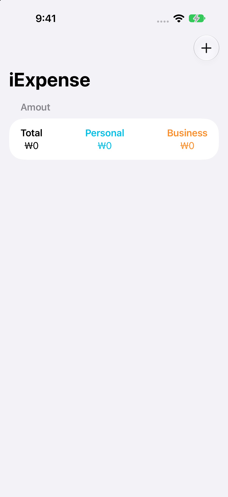
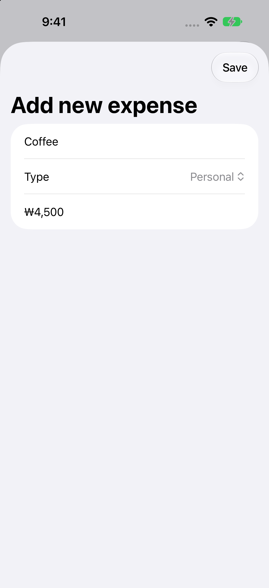
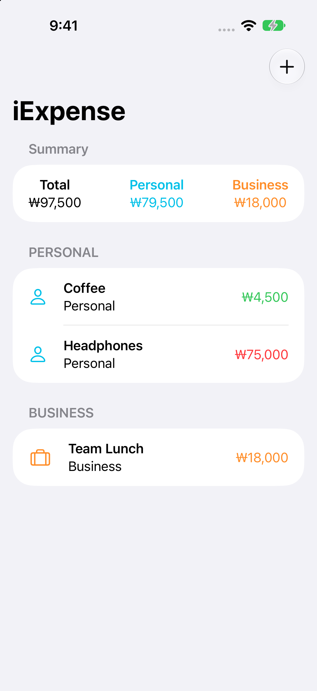

# iExpense

> [100 Days of SwiftUI](https://www.hackingwithswift.com/100/swiftui) · Day 36–37 · Project 7 · 진행 중

개인 지출과 업무 지출을 기록하고 앱을 재실행해도 내역을 유지하는 지출 관리 앱입니다.

## 주요 기능

- 지출 이름, 종류, 금액 입력 및 항목 추가·삭제
- 개인·업무 지출 아이콘과 색상 구분
- 총액, 개인 지출 합계, 업무 지출 합계 표시
- KRW 통화 표시 및 금액 구간별 색상 구분
- `UserDefaults`를 활용한 지출 내역 저장 및 복원

## 핵심 학습 내용

| 개념 | 적용 내용 |
| :--- | :--- |
| `@Observable`, `@State` | 참조 모델의 변경 관찰과 뷰에서의 수명 관리 |
| `Identifiable`, `UUID` | 지출 항목의 고유 식별자 관리 |
| `Codable`, `JSONEncoder`, `JSONDecoder` | 지출 배열을 Data로 변환하고 복원 |
| `UserDefaults`, `didSet` | 내역 변경 시 로컬 저장 |
| `.sheet`, `@Environment(\.dismiss)` | 추가 화면 표시와 닫기 |
| `.onDelete`, `IndexSet` | 리스트 항목 삭제 |
| 계산 프로퍼티 | 전체 및 종류별 금액 합계 계산 |

## 구현 및 학습 기록

- 금액을 10,000원 미만(초록), 10,000원 이상~50,000원 미만(주황), 50,000원 이상(빨강)으로 구분했습니다.
- 개인·업무 지출별 합계와 아이콘을 추가하고 원화 형식을 적용했습니다.
- 기본값이 지정된 `let id = UUID()`는 합성 디코딩 과정에서 저장된 ID를 복원하지 못할 수 있으므로, 현재 모델에서는 `var id = UUID()`를 사용합니다.
- `AddView`에 동일한 `Expenses` 인스턴스를 전달하여 저장 시 목록을 갱신하고 `dismiss()`로 모달을 닫습니다.

### 문제 해결 과정

- **문제 상황:**  
  지출 항목을 Personal과 Business로 구분하여 각각의 Section에 표시한 이후, 특정 항목을 삭제하면 선택한 항목이 아닌 다른 항목이 삭제되는 문제가 발생했다.

- **발생 원인:**  
  `filter()`를 사용하여 생성한 배열의 인덱스와 원본 배열의 인덱스가 일치하지 않았기 때문이다. `onDelete`에서 전달하는 `IndexSet`은 해당 `ForEach`에 사용된 배열을 기준으로 하지만, 기존 삭제 함수는 전달받은 인덱스를 원본 배열에 그대로 적용하고 있었다.

- **해결 방법:**  
  배열의 인덱스 대신 각 항목의 고유 식별자인 `UUID`를 이용하여 삭제하도록 수정했다. `map()`을 사용하여 필터링된 배열에서 삭제할 항목의 UUID를 추출한 후, `removeAll(where:)`과 `contains()`를 사용하여 원본 배열에서 동일한 UUID를 가진 항목을 삭제했다.

  ```swift
  func removeItems(at offsets: IndexSet, from items: [ExpenseItem]) {
      let ids = offsets.map { items[$0].id }

      expenses.items.removeAll {
          ids.contains($0.id)
      }
  }
  ```

- **새롭게 이해한 내용:**
  - `filter()`로 생성된 배열과 원본 배열의 인덱스는 서로 다를 수 있다.
  - `onDelete`의 `IndexSet`은 연결된 `ForEach`의 배열을 기준으로 전달된다.
  - `UUID`를 활용하면 배열 내 위치와 관계없이 특정 데이터를 식별할 수 있다.
  - `map()`을 사용하여 컬렉션의 요소를 다른 값으로 변환할 수 있다.
  - `removeAll(where:)`을 사용하면 특정 조건을 만족하는 요소를 모두 삭제할 수 있다.
  - 원본 데이터를 하나로 유지하고 필터링된 데이터를 화면에 표시하는 방식으로 데이터의 일관성을 유지할 수 있다. 이러한 설계 방식을 Single Source of Truth라고 한다.

## 실행 방법

1. 이 프로젝트 폴더의 `.xcodeproj` 파일을 Xcode에서 엽니다.
2. 프로젝트의 Deployment Target을 지원하는 iOS 시뮬레이터 또는 기기를 선택합니다.
3. `⌘R`로 빌드 및 실행합니다.

## 실행 화면

iPhone 18 Pro · iOS 27.2 · 라이트 모드 · 상태 표시줄 9:41에서 직접 실행해 촬영했습니다.

| 빈 지출 목록 | Coffee · 개인 지출 4,500원 입력 | 종류별 합계와 금액별 색상 |
| :---: | :---: | :---: |
|  |  |  |

## 향후 개선 방향

- 빈 이름·0원·음수 입력에 대한 유효성 검사 (완료)
- 개인 및 업무 내역의 섹션 분리 검토 (완료)
- 저장 오류 처리 및 저장·복원 테스트 추가

---

[전체 학습 목차로 돌아가기](../README.md)
